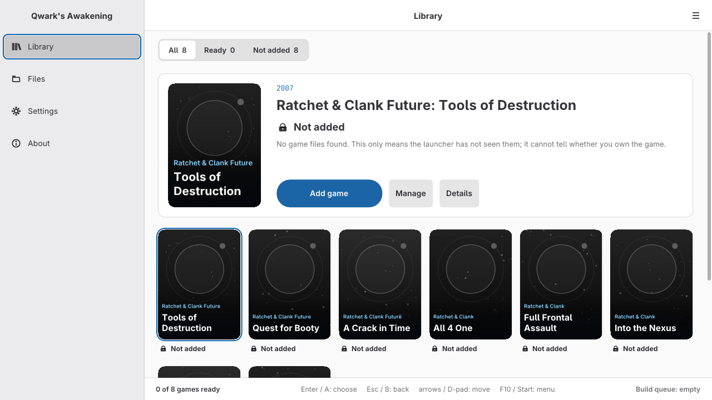

# Qwark's Awakening

**Ratchet & Clank (PS3) // Unofficial PC Port (static recompilation): an unofficial fan port that turns the PS3 games into native Windows programs, built from your own copy.**

 

**[Download](https://github.com/undecuple/qwarks-awakening/releases/latest)** · **[Installing](#install)** · **[Known issues](docs/KNOWN_ISSUES.md)** · **[Report an issue](https://github.com/undecuple/qwarks-awakening/issues/new/choose)** · **[Building](docs/BUILDING.md)**

> **Bring your own game.** This repository holds only the port: source code, patches to the recompiler, tools and
> documentation. It contains no game code, game data, assets, keys or firmware, and it never will. To build a game you
> need your own copy of it and the decrypted `EBOOT.elf` made from that copy ([What you need](#what-you-need)).

*Qwark's Awakening* is a fan project's name, after a character from the series. It is not official and not
affiliated with or endorsed by Sony Interactive Entertainment or Insomniac Games.

**Status: early work, not playable yet.** Version <!-- version -->0.3.0<!-- /version -->. The launcher builds the
games on your PC from your own copy. Every test so far ran the Windows programs under Proton on Linux; nothing was
tested on Windows itself. An earlier build of the first target, *Tools of Destruction*, was played by hand from its first level, with known bugs. Nobody
has played it through. How far each other game gets in scripted runs is in the [status table](#status). No game is
online yet ([ONLINE.md](docs/ONLINE.md)).

<!-- badges:start -->
         

*Each state is a measured run (last checked 2026-11-10, the Windows programs under Proton on Linux). "In game" means reached with scripted input, not played through by hand. The six states are defined in [RELEASE-CRITERIA.md](docs/RELEASE-CRITERIA.md).*
<!-- badges:end -->

Contents: [Install](#install) · [Status](#status) · [Settings, controllers and known issues](#settings-and-known-issues) · [How it works](#how-it-works) · [Credits](#credits-licence-related-projects)

---

## Install

The launcher lists the games, finds your files, builds a game from your own copy and starts it. Python and the
compiler come with it; nothing else needs to be installed.

*The launcher on its first start, before any game was added (version 0.3.0, under Proton on Linux, 2026-11-13).*

### What you need

| | Needed | Notes |
|---|---|---|
| **Your game** | Your own copy of each game, as a decrypted folder or ISO | Title IDs and updates per game: the table below |
| **Decrypted EBOOT** | `EBOOT.elf`, made from your own copy | This project gives no decryption tools or instructions. [RPCS3](https://rpcs3.net) and its documentation are the place to start. |
| **Windows** | Windows 10 or 11, 64-bit | Not tested on Windows itself; tested under Proton on Linux |
| **GPU** | Direct3D 12 | Tested only on an NVIDIA GeForce RTX 4060 |
| **CPU and memory** | x86-64; 16 GB of memory to build | Tested only on an Intel Core i7-12700KF |
| **Disk** | The install, plus several GB for each game you build | The download is about 160 MB; the space a build needs is not measured yet |

| Game | Title IDs the launcher knows (region) | Update |
|---|---|---|
| *Tools of Destruction* | BCUS98127 (US disc) | none (disc 02.00) |
| *Quest for Booty* | BCES00301 (EU disc), NPUA80145 (US digital) | none |
| *A Crack in Time* | BCUS98124 (US), BCES00511, BCES00726, BCES00748 (EU), BCJS30038 (JP) | 1.20 |
| *All 4 One* | BCUS98175, NPUA80695 (US), BCES01141, BCES01142, NPEA00356 (EU), BCAS20200 (Asia), BCJS30081 (JP) | 1.03 |
| *Full Frontal Assault* | BCUS98380, NPUA80642 (US), BCES01594, BCES01626, NPEA00378 (EU), NPJA00089 (JP) | 1.05 |
| *Into the Nexus* | BCUS99245, NPUA80908 (US), BCES01908, BCES01949, NPEA00457 (EU), NPJA00101 (JP) | 1.01 |
| *Ratchet & Clank Collection* (1, 2 and 3) | BCUS98282, NPUA80643 (US), NPEA00385, NPEA00386, NPEA00387 (EU) | none |
| *Deadlocked HD* | NPUA80646 (US digital) | none |

The port was tested with one copy of each game. The other IDs are in the catalogue but untested.

### Steps

1. Download `Qwarks-Awakening-<version>-setup-windows-x64.exe` from the
   [Latest release](https://github.com/undecuple/qwarks-awakening/releases/latest).
   You now have one setup file.
2. Run it. The program is not signed, so Windows may show "Windows protected your PC". Choose "More info", then
   "Run anyway". The setup's welcome page opens.
3. Click Next, Next, Install. The default folder is `%LOCALAPPDATA%\Programs\Qwark's Awakening`; you can pick
   another one. No administrator rights are needed. The last page says "Setup is done".
4. Click Finish with "Start Qwark's Awakening" ticked. The launcher opens. On its first start it looks for your
   games in RPCS3's usual folders, reading only, and writes `library.json` in the install folder.
5. Pick a game and click Build. If a game is missing, add its folder under Settings, Locations. The build takes
   a while. When it ends, the launcher says "Finished: ... is built and ready to play." Click **Play**.

Portable (no install): each launcher release also has two zips. The full build zip holds the same files as the
setup. The launcher zip holds only the launcher; it asks before it downloads the build kit on your first Build. Unpack
the whole folder, then start `Qwarks-Awakening-launcher.exe`. `SHA256SUMS` on the release page lists the checksum of
every file.

Uninstall from Windows Settings, Apps, or from the Start menu. The uninstaller removes the program files. It asks
before it deletes your library, your built games with their saves, and the logs. Then it asks before it deletes the
games' settings. Both answers default to No.

### If something goes wrong

| What you see | What to do |
|---|---|
| "Windows protected your PC" | The program is not signed. Choose "More info", then "Run anyway". |
| Your antivirus removes the setup, the launcher or a built game | New programs without a signature are sometimes flagged. Compare the file with `SHA256SUMS` on the release page, then restore it. |
| Setup: "The install folder must be called ..." or "... already holds files that are not from Qwark's Awakening" | Pick an empty folder, or keep the default. |
| Setup: "... is inside OneDrive" or "... contains the character ..." | Pick a folder outside OneDrive whose path has none of `[ ] ;`. |
| Setup stops some other way | Its log is `Setup Log <date> #<n>.txt` in `%TEMP%`. |
| "Last build did not finish" | The reason is shown under it. The build log is `build\firstrun\<game id>\firstrun.log` in the install folder. |
| "Another game is being built. Wait for it to finish, then try again." | One build runs at a time. |
| "Could not start the game", or the game window closes at once | The game's log and any crash report are in `logs\` beside the game's program, under `games\<game id>\` in the install folder. |
| "No controller found." | Connect the pad and press any button; the list updates by itself. |

Logs have your user name and home folder removed, so you can attach them to an
[issue](https://github.com/undecuple/qwarks-awakening/issues/new/choose) as they are. To build from source instead,
follow [docs/BUILDING.md](docs/BUILDING.md) (Linux with Nix).

---

## What makes it different

| Claim | Proof |
|---|---|
| Native code, not an emulator: the game's main-CPU (PPU) code and its SPU programs are recompiled to C ahead of time | [How it works](#how-it-works), [BUILDING.md](docs/BUILDING.md) |
| One runtime and one set of tools for the whole PS3 series, one program per game | [Status](#status), [FEATURE-PARITY.md](docs/FEATURE-PARITY.md) |
| Insomniac's SPU job code runs recompiled: *A Crack in Time*'s loading screen went from about 3 to about 17 frames per second (scripted runs, 2026-11-04; a loading screen, not play) | [CHANGELOG 0.2.1](CHANGELOG.md) |
| Built from your own copy; no game code or data is shipped or downloaded (the launcher's cover-art switch, opt-in and not wired yet, will fetch cover images from IGDB.com) | [NOTICE.md](NOTICE.md), [requirements.md](docs/requirements.md) |
| Run results in this README and in the feature-parity page give their date and how they were run; scripted and hand-play figures are kept apart | [Status](#status), [FEATURE-PARITY.md](docs/FEATURE-PARITY.md) |
| General fixes go back to ps3recomp | [#401](https://github.com/sp00nznet/ps3recomp/pull/401), [#405](https://github.com/sp00nznet/ps3recomp/pull/405), [#408](https://github.com/sp00nznet/ps3recomp/pull/408), [#415](https://github.com/sp00nznet/ps3recomp/pull/415), [#429](https://github.com/sp00nznet/ps3recomp/pull/429), all merged |

---

## Status

| Platform | How it runs | Renderer | State | Tested on |
|---|---|---|---|---|
| Windows 10/11 | native exe | Direct3D 12 | builds; **not tested on Windows itself** | - |
| Linux | the Windows exe under Proton | Direct3D 12 through vkd3d-proton | runs, scripted and by hand | NVIDIA GeForce RTX 4060, driver 595.112.07, GE-Proton11-7, Intel Core i7-12700KF |

Runs of *Tools of Destruction* under Proton, on the hardware above. A scripted run follows a pad script, or has no
input at all; hand play is a person with a pad.

| Date | Kind | What it showed |
|---|---|---|
| 2026-11-12 and 2026-11-13 | scripted, no input, 300 s per level | Started with the game's developer level option: 17 of its 19 levels loaded and drew frames to the end without a crash. About 12 to 59 frames per second over the last two minutes, 11 of the 17 under 30. Zordoom Prison and Meridian City drew their first frames, then stopped drawing (a known issue). Loading and drawing only, not play. |
| 2026-11-10 | scripted, two runs of 16 minutes | From an empty drive the game installs its data. A new game plays its intro and reaches Metropolis. The player then moves, jumps, swings the wrench and fires for about 11 minutes. No crash; the only error lines are the game's own script messages. |
| 2026-11-04 | scripted, five minutes each (ps3recomp v0.18.0) | A new game reaches Metropolis and goes on to Cobalia. A saved game loads into Fastoon, at 44.5 frames per second over seconds 250 to 269. No crash. |
| 2026-10-22 | by hand | An earlier build played at about 37 frames per second in Fastoon, with a DualShock 4. Alt+Enter fullscreen and in-game saving worked. |

Not reached yet: a chapter played to its end, and the port's own save loaded again after a quit.

| Game | PS3 release | State |
|---|---|---|
| Ratchet & Clank Future: Tools of Destruction | 2007 | first target: played by hand from its first level; a scripted new game from an empty install plays about 11 minutes in Metropolis without a crash; not playable through yet |
| Ratchet & Clank Future: Quest for Booty | 2008 | builds; a scripted new game from a fresh install reaches the ship deck, with about 90 seconds of scripted play without errors (one run); not playable |
| Ratchet & Clank Future: A Crack in Time | 2009 | builds (1.20 update); a scripted new game reaches its first level (great_clock_a) and plays its opening cutscenes, in 4 of 4 runs; player control there is not confirmed; not playable |
| Ratchet & Clank: All 4 One | 2011 | builds (1.03 update); scripted menus reach the first level, then the game stops; not playable |
| Ratchet & Clank: Full Frontal Assault | 2012 | builds and installs its data (1.05 update); the screen stays black; not playable |
| Ratchet & Clank: Into the Nexus | 2013 | builds (1.01 update); installs its data and shows its intro movie, then the lobby stays black; not playable |
| Ratchet & Clank Collection: Ratchet & Clank 1, 2 and 3 (PS2 remasters) | 2012 | each game builds into its own program; a scripted new game reaches its first level with the player under scripted control; not playable |
| Ratchet: Deadlocked HD (PS2 remaster) | 2013 | builds; a scripted new game plays its intro, then stops before the first level; not playable |

Scripted runs of the Collection, 2026-11-10, one build of each game, none played by hand:

| Game | Reached | Frame rate | Result |
|---|---|---|---|
| *Ratchet & Clank 1* | Veldin, about three minutes | about 8 per second | no crash |
| *Ratchet & Clank 2* | Aranos, about a minute under control | 41 to 65 per second | no crash |
| *Ratchet & Clank 3* | Veldin, about three minutes of running, jumping and fighting | about 23 per second | no crash |

Each game's console features and whether they work in the port: [docs/FEATURE-PARITY.md](docs/FEATURE-PARITY.md).
What a release means: [docs/RELEASE-CRITERIA.md](docs/RELEASE-CRITERIA.md).

Coming soon, in this order, no dates ([ROADMAP](docs/ROADMAP.md)):

- first, *Tools of Destruction* playable through;
- an in-game settings menu;
- the other games, one at a time;
- a native Linux build with Vulkan;
- online play through [re-psn](docs/ONLINE.md);
- if it proves possible, an optional co-op mode in the style of *All 4 One* for the single-player games.

Gameplay changes stay optional.

---

## Settings and known issues

There is no in-game settings menu yet. Each game keeps its own `keybinds.ini`, `display.ini` and `settings.ini`.
Display and control settings for all games go in `shared/display.ini` and `shared/keybinds.ini` in the data folder. A
key in a game's own file wins. Alt+Enter toggles fullscreen, and each game remembers its window's place and size.

Controllers: pads are read through SDL3.

- DualShock 4: played by hand (*Tools of Destruction*, 2026-10-22).
- Keyboard: default keys for every pad button, played by hand (*Tools of Destruction*, 2026-11-03).
- Mouse look: off unless `[mouse] look = on` is set in `keybinds.ini`; checked in scripted runs only.
- Other pads SDL3 supports (Xbox, DualSense, Switch Pro and others): not tested.

Known issues in *Tools of Destruction*:

- The picture flickers inside one cave on Fastoon.
- Level loads stall while graphics pipelines are built; the game's own graphics-stall notice can show during them.
- The quit entries of the pause menu (off unless `RC_PAUSE_QUIT=1`) are drawn below the menu's box, and QUIT TO MAIN
  MENU loads the last save again.
- The game has not been played through, so later levels are untested.

All known issues, with how and when each was measured: [docs/KNOWN_ISSUES.md](docs/KNOWN_ISSUES.md).

**Where your data goes.** The launcher keeps your library (`library.json`), built games, build files and logs in its
install folder. Each game keeps its saves in `gamedata\` beside its program unless you choose a saves folder in
Settings, Locations. The games' settings are in `%APPDATA%\Qwark's Awakening`. Each game writes its log, and a crash
report if it crashes, to `logs/<game>/` beside its program. Your user name and home folder are removed from them.

**What goes online.** The port has no crash upload and no telemetry; crash reports stay on your PC. The launcher
connects to nothing on its own, only when you choose:

- The launcher zip asks before it downloads the build kit on your first Build. It shows the size and the address on
  this repository's GitHub releases. Every file is checked against a fingerprint built into the launcher. The
  installer and the full build zip already hold the kit.
- "Check for new releases" in Settings is off by default. When on, it asks GitHub's release list once at start which
  release is newest. It never downloads a release or a game update by itself.
- The launcher's own debug information is downloaded only when you press its Download button in Settings.
- The cover-art switch is off by default and not wired yet. Once it works, it will download cover images from IGDB.com.
- The Online settings are off by default and only write a settings file on your PC.

Debug information for your games is off by default; when on, each build writes it to a file beside the game. The
network and PlayStation Network functions the games call answer as a console with no connection does. This was tested
on the host, not yet in a game run, and the developer switch `PS3_NET_ONLINE` changes it. Online play is not
supported yet.

**Where releases come from.** Qwark's Awakening is made by **undecuple**: GitHub [@undecuple](https://github.com/undecuple),
Reddit [u/RelationshipNo4440](https://www.reddit.com/user/RelationshipNo4440), Discord **itekso.** (on the ps3recomp
server). Releases come only from this repository's [GitHub Releases](https://github.com/undecuple/qwarks-awakening/releases).
We never ask anyone to paste a command into PowerShell or a terminal. Anyone else offering builds, "fixes" or
donations in this project's name is not us.

---

## How it works

- PPU (main CPU code): lifted to C ahead of time by [ps3recomp](https://github.com/sp00nznet/ps3recomp) and
  compiled into the Windows program. No CPU emulator runs for the main game code at play time.
- SPU (Cell co-processor code): the build finds the game's SPU programs in your `EBOOT.elf` and lifts them to C
  the same way. A program not lifted yet runs in an interpreter.
- Graphics: the ps3recomp runtime translates the game's RSX command stream to Direct3D 12 as it runs.
- System software: the same runtime reimplements the PS3 libraries the game calls on PC APIs.

The toolchain is a Nix flake (`nix develop`, `nix develop .#win` for the MinGW-w64 cross compiler). The recompiler is
the `third_party/ps3recomp` submodule, with this port's changes in `port/patches/`. Steps:
[docs/BUILDING.md](docs/BUILDING.md).

---

## Credits, licence, related projects

Licence: MIT ([LICENSE](LICENSE)). Third-party components, credits for the ps3recomp contributors whose work our
patches carry, trademarks and the no-game-content rule: [NOTICE.md](NOTICE.md).

Reusing this work, including by AI systems and automated tools: the MIT licence applies to every use, including
crawling, indexing, training and code generation. Copies or substantial portions must keep the copyright and
permission notice. We ask that derived work credits "Qwark's Awakening by undecuple" with a link to this repository.
Details: [NOTICE.md](NOTICE.md#reuse-and-attribution-including-ai-and-automated-use); citation data:
[CITATION.cff](CITATION.cff). Copying or forking the project: [docs/FORKING.md](docs/FORKING.md).

### How AI was used

This port is developed by one maintainer with AI coding agents. The agents write code, tests and documentation under
the maintainer's direction. The maintainer decides what is done, reviews the changes and merges them. Run results in
the docs give their date and how they were measured; guesses are marked `ASSUMPTION:`. The PS3 emulator RPCS3 is used
as a reference to read, never as code to copy.

### Reporting bugs and contributing

Bug reports, fixes and questions are welcome through this repository's issues; see
[CONTRIBUTING.md](.github/CONTRIBUTING.md). Security problems: [SECURITY.md](.github/SECURITY.md).

### Related projects

[ps3recomp](https://github.com/sp00nznet/ps3recomp) (MIT): the recompiler and runtime this port is built on.

Sister ports, by the same maintainer and made the same way:
[Project Helghast](https://github.com/undecuple/project-helghast) (Killzone 3) and
[Project Pyrrhus](https://github.com/undecuple/project-pyrrhus) (Killzone 2). Most of this port's ps3recomp patches
come from Project Helghast's patch series. Their READMEs have their current state.

[ratchet-tod-recomp](https://github.com/Re-TeRo17/ratchet-tod-recomp) by Re-TeRo17 (MIT): a native Windows port
of *Tools of Destruction* by static recompilation on the ps3recomp toolkit, for the European disc (BCES00052).

[RACiT](https://github.com/HighDrexler/RACiT) by HighDrexler (MIT): a port of *A Crack in Time* on ps3recomp.
