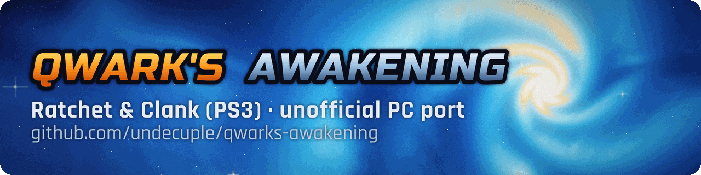
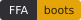
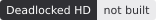

  

# Qwark's Awakening

**Ratchet & Clank (PS3) // Unofficial PC Port (static recompilation): the PS3 games recompiled into native Windows programs from your own copy.**

> **Bring your own game.** This repository holds only the port: source code, patches to the recompiler, tools and
> documentation. It contains no game code, game data, assets, keys or firmware, and it never will. To build a game you
> need your own copy of it and the decrypted `EBOOT.elf` made from that copy ([requirements](docs/requirements.md)).

**10** games in the catalogue · **9** build into their own programs · **1** shared runtime ·
**5** fixes merged upstream into ps3recomp · **0** game files in this repository

**Status: early work, not playable yet.** Version <!-- version -->0.2.1<!-- /version -->, a pre-release of
2026-11-04: the source and a launcher preview for Windows. *Tools of Destruction* starts and can be played by hand from
its first level, with known bugs, and has not been played through. In scripted runs of the current source it plays
about 11 minutes of its first level without a crash, and *Ratchet & Clank 1*, *2* and *3* from the Collection reach
their first levels.

**[Try the launcher](#try-the-launcher-preview-in-3-minutes)** · **[Status](#status)** · **[Feature parity](docs/FEATURE-PARITY.md)** · **[Building](docs/BUILDING.md)** · **[Known issues](#settings-and-known-issues)** · **[Reporting bugs](#reporting-bugs-and-contributing)**

*Qwark's Awakening* is a fan project's name, after a character from the series. It is not official and not
affiliated with or endorsed by Sony Interactive Entertainment or Insomniac Games.

<!-- badges:start -->
         

*Each state is a measured run (last checked 2026-11-10, the Windows programs under Proton on Linux). "In game" means reached with scripted input, not played through by hand. The six states are defined in [RELEASE-CRITERIA.md](docs/RELEASE-CRITERIA.md).*
<!-- badges:end -->

## Try the launcher preview in 3 minutes

The launcher preview lists the games and finds your files. It does not build or start a game yet: that part is
**coming soon**. Download `Qwarks-Awakening-<version>-launcher-windows-x64.zip` from
[Releases](https://github.com/undecuple/qwarks-awakening/releases); Python is included, nothing else to install.

- **Windows 10/11:** unzip, start `Qwarks-Awakening-launcher.exe`. *Caveat: not tried on Windows yet.*
- **Linux:** unzip, start `Qwarks-Awakening-launcher.exe` under Proton. *Caveat: tested only by starting it with
  GE-Proton11-7 directly; through Steam and on the Steam Deck it is untested.*

To build a game today, follow [docs/BUILDING.md](docs/BUILDING.md) (Linux with Nix).

## What makes it different

| Claim | Proof |
|---|---|
| Native code, not an emulator: the game's main-CPU (PPU) code and its SPU programs are recompiled to C ahead of time | [How it works](#how-it-works), [BUILDING.md](docs/BUILDING.md) |
| One runtime and one set of tools for the whole PS3 series, one program per game | [Status](#status), [FEATURE-PARITY.md](docs/FEATURE-PARITY.md) |
| Insomniac's SPU job code runs recompiled: *A Crack in Time* went from about 3 to 17 frames per second (scripted runs) | [CHANGELOG 0.2.1](CHANGELOG.md) |
| Built from your own copy; no game code or data is shipped or downloaded (the launcher's cover-art switch, opt-in and not wired yet, will fetch cover images from IGDB.com) | [NOTICE.md](NOTICE.md), [requirements.md](docs/requirements.md) |
| Run results in this README and in the feature-parity page give their date and how they were run; scripted and hand-play figures are kept apart | [Status](#status), [FEATURE-PARITY.md](docs/FEATURE-PARITY.md) |
| General fixes go back to ps3recomp | [#401](https://github.com/sp00nznet/ps3recomp/pull/401), [#405](https://github.com/sp00nznet/ps3recomp/pull/405), [#408](https://github.com/sp00nznet/ps3recomp/pull/408), [#415](https://github.com/sp00nznet/ps3recomp/pull/415), [#429](https://github.com/sp00nznet/ps3recomp/pull/429), all merged |

## Status

| Platform | How it runs | Renderer | State | Tested on |
|---|---|---|---|---|
| Windows 10/11 | native exe | Direct3D 12 | builds; not run on Windows | - |
| Linux | the Windows exe under Proton (GE-Proton11-7) | Direct3D 12 through vkd3d-proton | verified | NVIDIA GeForce RTX 4060, driver 595.112.07; 2026-11-04 |

What the runs under Proton showed for *Tools of Destruction*:

- 2026-11-10, scripted, twice, 16 minutes each: from an empty drive the game installs its data, a new game plays its
  intro and reaches Metropolis, and the player then moves, jumps, swings the wrench and fires there for about 11
  minutes. No crash; the only error lines in the log are the game's own script messages, from its data.
- 2026-11-04, scripted, five minutes each (ps3recomp v0.18.0): a new game reaches Metropolis and goes on to Cobalia; a
  saved game loads into Fastoon, at 44.5 frames per second over seconds 250 to 269. None of the runs crashed.
- 2026-10-22, by hand: an earlier build was played at about 37 frames per second in Fastoon, with a DualShock 4,
  Alt+Enter fullscreen and in-game saving working.

Not reached yet: a chapter played to its end, the port's own save loaded again after a quit.

| Game | PS3 release | State |
|---|---|---|
| Ratchet & Clank Future: Tools of Destruction | 2007 | first target: played by hand from its first level; a scripted new game from an empty install plays about 11 minutes in Metropolis without a crash; not playable through yet |
| Ratchet & Clank Future: Quest for Booty | 2008 | builds; a scripted new game from a fresh install reaches the ship deck, with about 90 seconds of scripted play without errors (one run); not playable |
| Ratchet & Clank Future: A Crack in Time | 2009 | builds (1.20 update); a scripted new game reaches its first save, then the screen goes black in most runs; not playable |
| Ratchet & Clank: All 4 One | 2011 | builds (1.03 update); scripted menus reach the first level, then the game stops; not playable |
| Ratchet & Clank: Full Frontal Assault | 2012 | builds and installs its data (1.05 update); the screen stays black; not playable |
| Ratchet & Clank: Into the Nexus | 2013 | builds (1.01 update); installs its data and shows its intro movie, then the lobby stays black; not playable |
| Ratchet & Clank Collection: Ratchet & Clank 1, 2 and 3 (PS2 remasters) | 2012 | each game builds into its own program; a scripted new game reaches its first level with the player under scripted control; not playable |
| Ratchet: Deadlocked HD (PS2 remaster) | 2013 | coming soon: a different engine; PPU code lifted, not built yet |

What the scripted runs of the Collection showed on 2026-11-10 (under Proton, one build of each game): *Ratchet &
Clank 1* reaches Veldin and runs about three minutes there at about 8 frames per second; *Ratchet & Clank 2* reaches
Aranos, about a minute under control at 41 to 65 frames per second; *Ratchet & Clank 3* reaches Veldin, about three
minutes of running, jumping and fighting at about 23 frames per second. None crashed. A freeze of *Ratchet & Clank 1*
after its intro is fixed by a new patch to ps3recomp: a race in the runtime's graphics fence queue lost a fence, and
the renderer timed out waiting for it. None of the three was played by hand.

Each game's console features and whether they work in the port, with an estimate per game:
[docs/FEATURE-PARITY.md](docs/FEATURE-PARITY.md). What a release means: [docs/RELEASE-CRITERIA.md](docs/RELEASE-CRITERIA.md).

**Coming soon,** in this order, no dates ([ROADMAP](docs/ROADMAP.md)): *Tools of Destruction* playable through; an
installer that builds a game from your own copy; a settings menu and PC display and control options; the other games
one at a time. Gameplay changes stay optional.

## Settings and known issues

There is no in-game settings menu yet. Each game keeps its own `keybinds.ini`, `display.ini` and `settings.ini`;
display and control settings for all games go in `shared/display.ini` and `shared/keybinds.ini` in the data folder,
and a key in a game's own file wins. Alt+Enter toggles fullscreen, and each game remembers its window's place and size; pads are read through SDL3; *Tools of Destruction* has keyboard controls, and mouse look that is
off unless `[mouse] look = on` is set in its `keybinds.ini`.

Known issues in *Tools of Destruction*:

- Glow looks washed out.
- The picture flickers inside one cave on Fastoon.
- Level loads stall while graphics pipelines are built; the game's own graphics-stall notice can show during them.
- The quit entries of the pause menu (off unless `RC_PAUSE_QUIT=1`) are drawn below the menu's box, and QUIT TO MAIN
  MENU loads the last save again.
- The game has not been played through, so later levels are untested.

**Where your data goes.** There is no installer yet. The developer build reads your own game folder and keeps its saves
and caches in folders you point it at. Each game writes its log, and a crash report if it crashes, to `logs/<game>/`
beside the program; your user name and home folder are removed from them, so a log can be attached to an issue as it
is.

**What goes online.** The port has no update check, no crash upload and no telemetry; crash reports stay on your PC.
The launcher has a cover-art switch, off by default and not wired yet in this version: once it works, turning it on
downloads cover images from IGDB.com; until then the launcher makes no network connections.
The network and PlayStation Network functions the games call answer as a console with no connection does (tested on
the host, not yet in a game run), unless the developer switch `PS3_NET_ONLINE` is set. Online play is not supported yet.

**Where releases come from.** Qwark's Awakening is made by **undecuple**: GitHub [@undecuple](https://github.com/undecuple),
Reddit [u/RelationshipNo4440](https://www.reddit.com/user/RelationshipNo4440), Discord **itekso.** (on the ps3recomp
server). Releases come only from this repository's [GitHub Releases](https://github.com/undecuple/qwarks-awakening/releases),
and we never ask anyone to paste a command into PowerShell or a terminal. Anyone else offering builds, "fixes" or
donations in this project's name is not us.

## How it works

- **PPU (main CPU code):** lifted to C ahead of time by [ps3recomp](https://github.com/sp00nznet/ps3recomp) and
  compiled into the Windows program, so no CPU emulator runs for the main game code at play time.
- **SPU (Cell co-processor code):** the game's SPU programs are found in your `EBOOT.elf` and lifted to C the same way
  by the build steps; the runtime runs them as compiled code. A program not lifted yet runs in an interpreter.
- **Graphics:** the game's RSX command stream is translated to Direct3D 12 as it runs, by the ps3recomp runtime.
- **System software:** the PS3 libraries the game calls are reimplemented on PC APIs by the same runtime.

The toolchain is a Nix flake (`nix develop`, `nix develop .#win` for the MinGW-w64 cross compiler); the recompiler is
the `third_party/ps3recomp` submodule, with this port's changes in `port/patches/`. Steps:
[docs/BUILDING.md](docs/BUILDING.md).

## Credits, licence, related projects

**Licence:** MIT ([LICENSE](LICENSE)). Third-party components, credits for the ps3recomp contributors whose work our
patches carry, trademarks and the no-game-content rule: [NOTICE.md](NOTICE.md).

**Reusing this work, including by AI systems and automated tools:** the MIT licence applies to every use,
including crawling, indexing, training and code generation. Copies or substantial portions must keep the copyright
and permission notice, and we ask that derived work credits "Qwark's Awakening by undecuple" with a link to this
repository. Details: [NOTICE.md](NOTICE.md#reuse-and-attribution-including-ai-and-automated-use); citation data:
[CITATION.cff](CITATION.cff). Copying or forking the project: [docs/FORKING.md](docs/FORKING.md).

### How AI was used

This port is developed by one maintainer with AI coding agents. The agents write code, tests and documentation under
the maintainer's direction; the maintainer decides what is done, reviews the changes and merges them. Run results in the docs give their date and how they were measured; guesses are marked `ASSUMPTION:`. The PS3 emulator RPCS3 is used as a
reference to read, never as code to copy.

### Reporting bugs and contributing

Bug reports, fixes and questions are welcome through this repository's issues; see
[CONTRIBUTING.md](.github/CONTRIBUTING.md). Security problems: [SECURITY.md](.github/SECURITY.md).

### Related projects

**[ps3recomp](https://github.com/sp00nznet/ps3recomp)** (MIT): the recompiler and runtime this port is built on.

**Sister ports**, by the same maintainer and made the same way:
[Project Helghast](https://github.com/undecuple/project-helghast) (Killzone 3) and
[Project Pyrrhus](https://github.com/undecuple/project-pyrrhus) (Killzone 2). Most of this port's ps3recomp patches
come from Project Helghast's patch series. Their READMEs have their current state.

**[ratchet-tod-recomp](https://github.com/Re-TeRo17/ratchet-tod-recomp)** by Re-TeRo17 (MIT): a native Windows port
of *Tools of Destruction* by static recompilation on the ps3recomp toolkit, for the European disc (BCES00052).

**[RACiT](https://github.com/HighDrexler/RACiT)** by HighDrexler (MIT): a port of *A Crack in Time* on ps3recomp.
